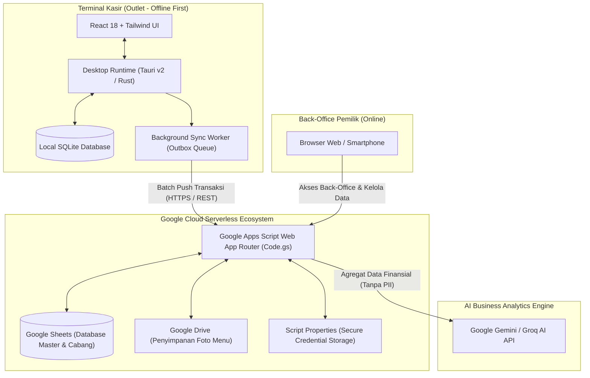
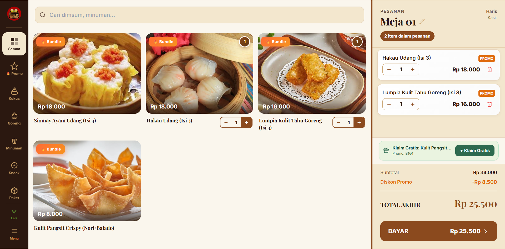
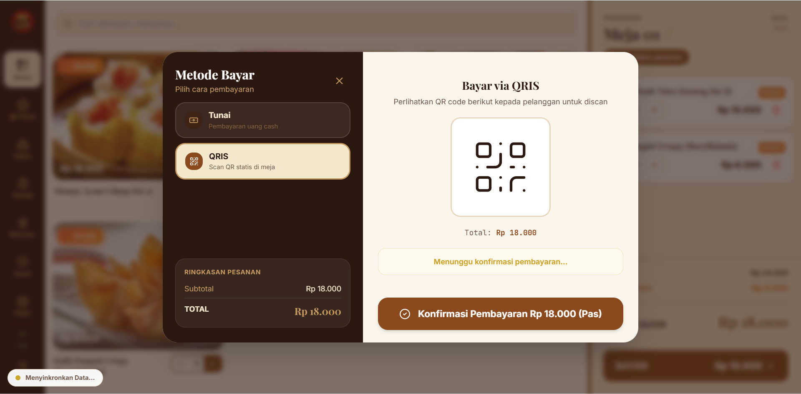
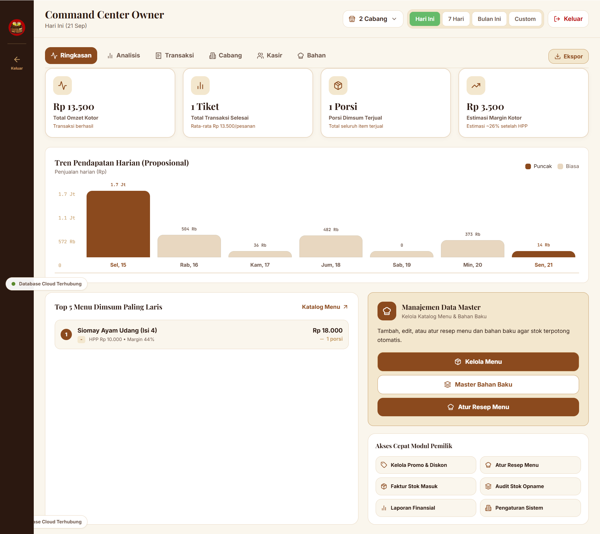
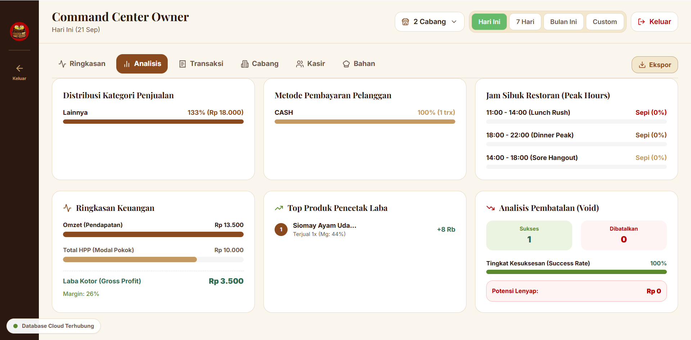
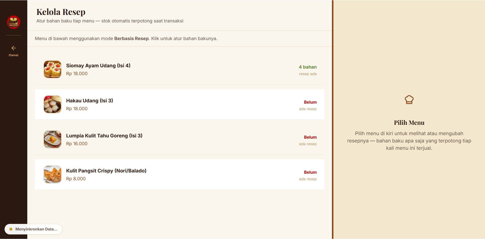
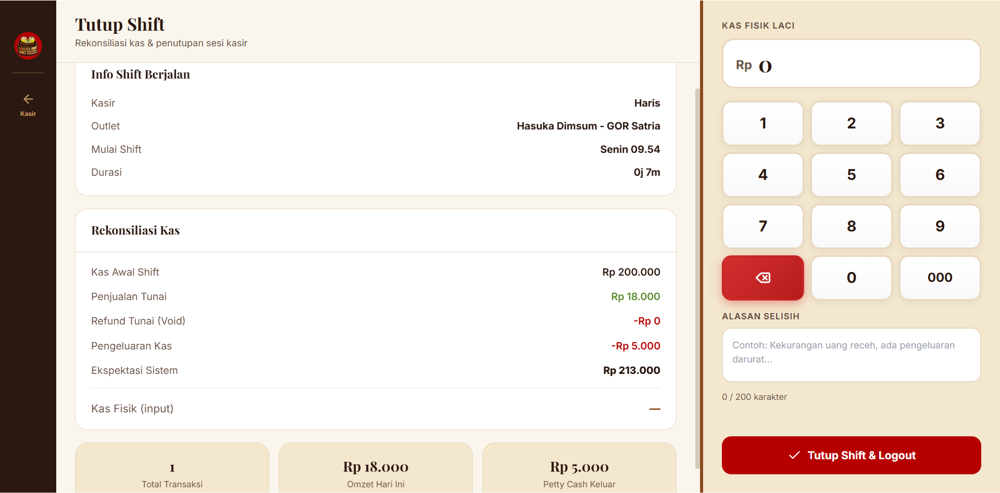

<div align="center">

# 🥟 POS Hasuka Dimsum

**Sistem Point of Sale (POS) & Back-Office Multi-Outlet Berbasis Arsitektur Hybrid Offline-First**

[](https://react.dev/)
[](https://www.typescriptlang.org/)
[](https://tauri.app/)
[](https://www.rust-lang.org/)
[](https://www.sqlite.org/)
[](https://developers.google.com/apps-script)
[](https://www.google.com/sheets/about/)
[](https://ai.google.dev/)
[](https://tailwindcss.com/)

---

Aplikasi kasir dan manajemen operasional restoran modern yang dirancang khusus untuk **Hasuka Dimsum** (Outlet GOR Satria Purwokerto & ekspansi cabang). Menggabungkan kecepatan transaksi instan di kasir menggunakan aplikasi desktop **Offline-First (Tauri + SQLite)** dengan kepraktisan pemantauan jarak jauh bagi pemilik usaha melalui **Google Workspace Serverless (Apps Script + Sheets + Gemini AI)** tanpa biaya langganan bulanan (*Zero Subscription / SaaS-Free*).

</div>

---

## 📌 Daftar Isi
- [Latar Belakang & Permasalahan](#-latar-belakang--permasalahan)
- [Solusi & Keunggulan Utama](#-solusi--keunggulan-utama)
- [Arsitektur Sistem (Hybrid Offline-First)](#-arsitektur-sistem-hybrid-offline-first)
- [Fitur Utama](#-fitur-utama)
  - [1. Terminal Kasir (POS)](#1-terminal-kasir-pos)
  - [2. Manajemen Shift & Petty Cash](#2-manajemen-shift--petty-cash)
  - [3. Manajemen Stok Berbasis Resep](#3-manajemen-stok-berbasis-resep-composition-based-inventory)
  - [4. Multi-Outlet & Hak Akses Terisolasi](#4-multi-outlet--hak-akses-terisolasi)
  - [5. Owner Dashboard & Rekap Finansial](#5-owner-dashboard--rekap-finansial)
  - [6. Sifu AI Business Insight](#6-sifu-ai-business-insight)
  - [7. Keamanan & Two-Tier Recovery Key](#7-keamanan--two-tier-recovery-key)
- [Tangkapan Layar Antarmuka](#-tangkapan-layar-antarmuka)
- [Teknologi yang Digunakan](#-teknologi-yang-digunakan)
- [Panduan Instalasi & Menjalankan](#-panduan-instalasi--menjalankan)
  - [Prasyarat Sistem](#prasyarat-sistem)
  - [Instalasi Lokal Frontend & Desktop](#instalasi-lokal-frontend--desktop)
  - [Konfigurasi Google Apps Script & Database](#konfigurasi-google-apps-script--database)
  - [Konfigurasi Sifu AI Business Insight](#konfigurasi-sifu-ai-business-insight)
- [Struktur Direktori Repositori](#-struktur-direktori-repositori)
- [Informasi Tim & Pengembang](#-informasi-tim--pengembang)
- [Lisensi & Ketentuan](#-lisensi--ketentuan)

---

## 📖 Latar Belakang & Permasalahan

Hasuka Dimsum merupakan unit usaha kuliner F&B yang berkembang di Purwokerto dengan outlet di FK Unsoed dan outlet GOR Satria. Pada outlet GOR Satria, volume operasional mencapai rata-rata 50+ transaksi per hari, namun operasional sebelumnya masih mengandalkan pencatatan nota fisik tulisan tangan.

Pola manual tersebut memunculkan sejumlah hambatan operasional:
1. **Risiko Kesalahan Pencatatan & Kecepatan Layanan**: Penulisan manual memperlambat antrean saat jam sibuk dan meningkatkan risiko salah hitung harga maupun kembalian.
2. **Ketiadaan Pelacakan Stok Bahan Baku Riil**: Produk dimsum diproduksi dari bahan baku (kulit siomay, isian daging, saus, kemasan). Sistem kasir konvensional yang hanya memotong stok produk jadi gagal mencerminkan sisa bahan baku di dapur.
3. **Ketergantungan Internet pada Kasir Cloud Murni**: Layanan POS berbasis cloud murni sering kali macet total ketika jaringan internet outlet terputus, sehingga pelayanan kasir terhenti.
4. **Beban Biaya Langganan SaaS Bulanan**: Layanan POS vendor pihak ketiga membebankan biaya rutin per terminal setiap bulannya, yang membebani efisiensi UMKM.

---

## 💡 Solusi & Keunggulan Utama

POS Hasuka Dimsum dibangun untuk menyelesaikan masalah di atas secara menyeluruh dengan prinsip rekayasa perangkat lunak modern:

- **Offline-First via Tauri & Local SQLite**: Kasir dapat menyelesaikan transaksi, mencetak struk, dan menghitung kembalian dalam hitungan milidetik secara lokal tanpa butuh internet. Antrean sinkronisasi (*outbox queue*) secara otomatis mengirimkan data ke cloud saat jaringan pulih.
- **100% Bebas Biaya Berlangganan (*Zero Subscription*)**: Seluruh backend dan database memanfaatkan ekosistem **Google Apps Script** dan **Google Sheets**. Pemilik usaha memiliki kendali penuh atas aset sistem tanpa biaya server bulanan.
- **Sistem Stok Berbasis Resep (*Composition-Based Recipe Inventory*)**: Setiap penjualan menu otomatis mengalkulasi dan memotong stok bahan baku/kemasan pembentuknya secara proporsional. Kartu menu di kasir menampilkan indikator *bottleneck* porsi riil yang dapat disajikan.
- **Multi-Outlet Terintegrasi**: Mendukung pemisahan data per-cabang (stok gudang outlet, rekonsiliasi kas shift, riwayat kasir) dalam satu basis data master produk terpusat.
- **Asisten AI Analisis Bisnis (Sifu AI)**: Terintegrasi dengan model AI (Google Gemini / Groq) untuk merangkum performa penjualan berkala, mendeteksi bahan baku yang kritis, dan menyajikan rekomendasi tindakan bisnis yang dapat langsung disalin ke WhatsApp pemilik usaha.

---

## 🏛️ Arsitektur Sistem (Hybrid Offline-First)



### Pola Sinkronisasi Data
1. **Transaksional Kasir**: Saat kasir memproses pesanan, data disimpan seketika ke tabel lokal SQLite dengan `client_generated_id` (UUID v4) dan status `pending_sync`.
2. **Background Sync Worker**: Worker memeriksa koneksi internet secara berkala. Ketika online, data antrean dikirimkan secara *idempotent batch* ke endpoint Google Apps Script.
3. **Data Resolusi**: Master data produk, resep, dan promo diperbarui ke kasir setiap kali shift dibuka atau kasir melakukan refresh katalog.

---

## 🚀 Fitur Utama

### 1. Terminal Kasir (POS)
- **Antarmuka Kasir Cepat**: Grid produk dengan tombol sentuh besar, pencarian instan, dan filter kategori (*Kukus*, *Goreng*, *Minuman*, dll.).
- **Indikator Bottleneck Porsi**: Kartu produk secara otomatis menampilkan estimasi sisa porsi berdasarkan bahan baku paling kritis di cabang tersebut.
- **Metode Pembayaran Lengkap**: 
  - Pembayaran **Tunai** dengan tombol kalkulasi nominal cepat (*quick cash*) dan kalkulasi uang kembalian otomatis.
  - Pembayaran **Non-Tunai** (QRIS Statis/Dinamis dan EDC Kartu).
- **Penomoran Struk & Nota**: Penomoran nota rapi dengan fitur reset otomatis nomor antrean (*sequence 001*) setiap pembukaan shift baru.
- **Pencetakan Struk**: Kompatibel dengan printer thermal POS standar (ESC/POS) dan pembuatan struk digital.

### 2. Manajemen Shift & Petty Cash
- **Buka Shift**: Kasir mencatat modal kas awal di laci kasir (*cash drawer*).
- **Pencatatan Kas Kecil (*Petty Cash*)**: Pengeluaran operasional darurat (misal: es batu, galon air, bumbu darurat) dapat dicatat kasir langsung dengan keterangan jelas.
- **Tutup Shift & Rekonsiliasi**: Kasir menghitung fisik uang tunai saat tutup shift; sistem mengomparasi total sistem vs kas fisik, menghitung selisih (lebih/kurang), dan menyajikan ringkasan pertanggungjawaban shift.

### 3. Manajemen Stok Berbasis Resep (Composition-Based Inventory)
- **Komposisi Resep Dinamis**: Pemilik usaha dapat menentukan takaran bahan baku untuk setiap menu (contoh: 1 porsi Siomay Ayam = 4 pcs siomay mentah + 1 pack saus dimsum).
- **Stok Opname**: Formulir pengecekan fisik berkala untuk mencocokkan stok gudang cabang dengan catatan sistem, dilengkapi riwayat log audit selisih.
- **Barang Masuk (*Stock In*)**: Modul pencatatan pasokan bahan baku masuk yang langsung menambah stok gudang cabang terpilih.

### 4. Multi-Outlet & Hak Akses Terisolasi
- **Stok & Transaksi Terisolasi**: Data transaksi, shift kasir, kas kecil, dan stok fisik diisolasi per outlet (contoh: Cabang GOR Satria vs Cabang FK Unsoed).
- **Pembagian Peran Pengguna**:
  - **Kasir**: Terikat pada cabang yang ditugaskan, hanya dapat mengakses menu penjualan, buka/tutup shift, dan petty cash.
  - **Owner**: Memiliki akses menyeluruh ke laporan penjualan seluruh cabang, manajemen cabang, master resep, dan konfigurasi sistem.

### 5. Owner Dashboard & Rekap Finansial
- **Visualisasi Metrik Bisnis**: Rangkuman omzet kotor/bersih, total tiket transaksi, rata-rata nilai transaksi (*basket size*), dan komparasi periode (Hari Ini vs Kemarin vs 7 Hari Terakhir).
- **Grafik Interaktif**: Menggunakan *Recharts* untuk membaca fluktuasi omzet harian dan pergerakan jam-jam sibuk (*peak hours*).
- **Laporan & Ekspor**: Riwayat transaksi detail dengan opsi filter tanggal, status pembayaran, kasir bertugas, dan ekspor data ke format spreadsheet.

### 6. Sifu AI Business Insight
- **Analisis AI Otomatis**: Membaca data tren penjualan tanpa mengirim data privasi (hanya agregat angka penjualan dan pergerakan stok).
- **Rekomendasi Cerdas**: Menemukan menu dengan penjualan tertinggi, bahan baku yang mendekati batas kritis, serta saran pengadaan bahan.
- **Ekspor Ringkasan ke WhatsApp**: Hasil analisis dapat disalin langsung dengan format teks rapi untuk dibagikan ke grup manajemen/pemilik usaha.

### 7. Keamanan & Two-Tier Recovery Key
- **Setup Wizard Terenkripsi**: Pendaftaran kredensial akun owner dan PIN kasir dilakukan saat inisialisasi awal.
- **Two-Tier Recovery**: Sistem menghasilkan kunci pemulihan 16 karakter acak kriptografis yang dapat diunduh untuk mereset kata sandi darurat jika kredensial terlupa.
- **Proteksi API Key**: Kunci API penyedia AI disimpan secara aman di sisi server (*Script Properties* Google Apps Script), tidak pernah diekspos ke sisi klien.

---

## 📸 Tangkapan Layar Antarmuka

| Layar Kasir POS | Modal Pembayaran QRIS |
| :---: | :---: |
|  |  |

| Dashboard Owner Ringkasan | Analisis Bisnis Sifu AI |
| :---: | :---: |
|  |  |

| Manajemen Resep Bahan Baku | Sesi Tutup Shift Kasir |
| :---: | :---: |
|  |  |

---

## 🛠️ Teknologi yang Digunakan

### Frontend & UI
- **React 18** & **TypeScript** — Struktur komponen reaktif dengan pengetikan tipe data yang ketat.
- **Tailwind CSS** — Penataan antarmuka responsif ramah layar sentuh kasir (tablet & smartphone) serta desktop back-office.
- **Lucide React** — Set ikon modern yang bersih dan konsisten.
- **Recharts** — Visualisasi analitik grafik penjualan di dashboard owner.
- **Vite** & **Vite Plugin Singlefile** — Bundling aplikasi web menjadi berkas tunggal yang dapat disematkan ke Google Apps Script.

### Desktop Runtime (Kasir Offline)
- **Tauri v2 (Rust)** — Runtime desktop ultra-ringan dengan konsumsi memori rendah dibandingkan Electron.
- **@tauri-apps/plugin-sql** & **SQLite** — Mesin penyimpanan basis data relasional lokal di perangkat kasir.

### Backend & Cloud Storage
- **Google Apps Script (GAS)** — Backend serverless gratis berbasis JavaScript untuk routing API dan sinkronisasi data.
- **Google Sheets** — Penyimpanan basis data tabel terstruktur yang dapat ditinjau langsung oleh owner kapan saja.
- **Google Drive API** — Penyimpanan aset gambar/foto produk makanan secara terorganisir.
- **Google Clasp (`@google/clasp`)** — Tool CLI untuk mengotomasi proses *deployment* kode lokal ke Apps Script.

### Kecerdasan Buatan (AI)
- **Google Gemini API** (dengan dukungan Groq / OpenAI compatible API) — Analitik data bisnis dan rekomendasi operasional F&B.

---

## 💻 Panduan Instalasi & Menjalankan

### Prasyarat Sistem
- **Node.js** versi 18.x atau lebih baru.
- **npm** atau **yarn**.
- **Rust Toolchain & Cargo** *(opsional, hanya diperlukan jika ingin meng-compile aplikasi desktop Tauri secara lokal)*: [https://rustup.rs/](https://rustup.rs/)

---

### Instalasi Lokal Frontend & Desktop

1. **Clone Repositori:**
   ```bash
   git clone https://github.com/Dialius/POS-Hasuka-Dimsum.git
   cd POS-Hasuka-Dimsum
   ```

2. **Masuk ke Direktori Aplikasi:**
   ```bash
   cd pos-kasir
   npm install
   ```

3. **Menjalankan Server Pengembangan Web:**
   ```bash
   npm run dev
   ```
   Aplikasi akan terbuka di browser lokal pada alamat `http://localhost:5173`.

4. **Menjalankan Aplikasi Kasir Desktop (Tauri):**
   ```bash
   npx @tauri-apps/cli dev
   ```

5. **Build Berkas Produksi (Singlefile HTML untuk Apps Script):**
   ```bash
   npm run build
   ```
   *Perintah ini menjalankan type-checking TypeScript, bundling Vite, dan secara otomatis menyalin bundle HTML ke folder `google-apps-script/Index.html`.*

---

### Konfigurasi Google Apps Script & Database

Untuk menghubungkan aplikasi ke Google Sheets sebagai database serverless gratis:

1. Buat spreadsheet baru di [Google Sheets](https://sheets.new) dengan nama `DB_Hasuka_POS`.
2. Klik menu **Ekstensi** > **Apps Script**.
3. Di editor Apps Script, salin berkas berikut dari direktori repositori:
   - Salin isi [`google-apps-script/Code.gs`](file:///d:/Client-Dimsum/google-apps-script/Code.gs) ke file `Code.gs`.
   - Buat berkas script baru bernama `SetupSheets.gs` dan salin isi [`google-apps-script/SetupSheets.gs`](file:///d:/Client-Dimsum/google-apps-script/SetupSheets.gs).
   - Buat berkas HTML bernama `Index.html` dan salin isi [`google-apps-script/Index.html`](file:///d:/Client-Dimsum/google-apps-script/Index.html).
4. Di bilah fungsi atas, pilih fungsi **`setupHasukaDatabase`** lalu klik **Run**. Berikan izin akses akun Google Anda saat diminta. Tab tabel database akan terbuat secara otomatis.
5. Klik **Deploy** > **New deployment** > pilih jenis **Web app**:
   - **Execute as**: `Me` (Akun Google Anda)
   - **Who has access**: `Anyone` *(Wajib disetel Anyone agar kasir dan owner dapat mengakses endpoint).*
6. Salin **Web app URL** yang berakhiran `/exec`.
7. Buka aplikasi POS Hasuka Dimsum di menu **Pengaturan** > **Integrasi**, tempel URL tersebut, lalu klik **Simpan & Tes Koneksi**.

---

### Konfigurasi Sifu AI Business Insight

1. Dapatkan API Key gratis di [Google AI Studio](https://aistudio.google.com/) (atau Groq Console).
2. Buka editor Google Apps Script proyek Anda > klik ikon gerigi **Project Settings** (Setelan Proyek).
3. Gulir ke bagian **Script Properties** (Properti Skrip), lalu tambahkan baris konfigurasi berikut:
   - `AI_PROVIDER`: `gemini` (atau `groq`)
   - `AI_API_KEY`: *(Tempel API Key rahasia Anda)*
   - `AI_MODEL`: `gemini-1.5-flash` (atau model aktif lainnya)
4. Klik **Save script properties**. Fitur AI Insight kini aktif dan siap digunakan dari Dashboard Owner!

---

## 📁 Struktur Direktori Repositori

```text
POS-Hasuka-Dimsum/
├── .github/                # Workflow CI/CD GitHub Actions
├── UI/                     # Dokumentasi visual tangkapan layar antarmuka
├── docs/                   # Log pengembangan teknis & panduan AI
│   └── AI-SETUP.md         # Panduan detail konfigurasi integrasi AI
├── figma/                  # Desain acuan antarmuka dan prototipe
├── google-apps-script/     # Backend serverless & database handler
│   ├── Code.gs             # REST API router & logika server-side
│   ├── SetupSheets.gs      # Inisialisasi skema tabel Google Sheets
│   ├── Index.html          # Bundle produksi aplikasi web kasir & back-office
│   └── PANDUAN_SETUP_GOOGLE_SHEETS.md
├── pos-kasir/              # Kode sumber utama klien kasir (React + Tauri)
│   ├── src/                # Komponen React, hooks, contexts, dan utilitas
│   │   ├── components/     # Komponen UI kasir, modal, shift, resep, AI
│   │   ├── context/        # State global aplikasi & sinkronisasi outlet
│   │   ├── services/       # Layanan API, SQLite storage, printer ESC/POS
│   │   └── types/          # Definisi TypeScript transaksional & entitas
│   ├── src-tauri/          # Konfigurasi desktop runtime Rust & plugin SQLite
│   ├── copy-gas.js         # Script otomatisasi build singlefile ke folder GAS
│   ├── deploy-gas.js       # Script deploy otomatis via Clasp
│   └── package.json        # Dependensi dan skrip proyek
├── prd/                    # Product Requirements Document (PRD 00 - 10)
├── Readme.txt              # Berkas pengumpulan jobsheet PSAJ
└── README.md               # Dokumentasi utama proyek repositori
```

---

## 👥 Informasi Tim & Pengembang

Aplikasi ini dikembangkan oleh **Tim ANCHOR** dari **Program Keahlian Pengembangan Perangkat Lunak dan Gim (PPLG) SMK Telkom Purwokerto** sebagai bagian dari pemenuhan tugas **Penilaian Sumatif Akhir Jenjang (PSAJ) Kolaborasi Tahun Ajaran 2026/2027**:

- **Mitra Klien**: Hasuka Dimsum (Outlet GOR Satria Purwokerto)
- **Repositori Resmi**: [https://github.com/Dialius/POS-Hasuka-Dimsum](https://github.com/Dialius/POS-Hasuka-Dimsum)
- **Tim Pengembang (Tim ANCHOR)**:
  1. **Daffa Nuzul Al Hafiz** — Ketua Tim / Project Lead & Sistem Analis
  2. **Putra Davinza** ([@Dialius](https://github.com/Dialius)) — Full-Stack Developer & Desktop Tauri Specialist
  3. **Dirga Anugroho** ([@Dirgantenkabies](https://github.com/Dirgantenkabies)) — Frontend Developer & UI/UX Specialist

---

## 📄 Lisensi & Ketentuan

Sistem ini dikembangkan secara independen dan diserahterimakan kepada pihak **Hasuka Dimsum** sesuai klausul Berita Acara Serah Terima (BAST). Seluruh hak kepemilikan aset digital (berkas Google Spreadsheet, Google Apps Script, dan source code aplikasi) diserahkan penuh kepada klien tanpa biaya langganan bulanan.
