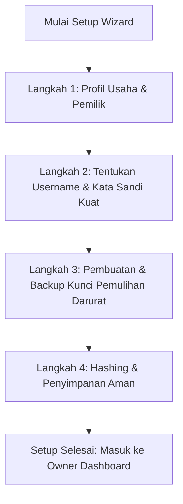
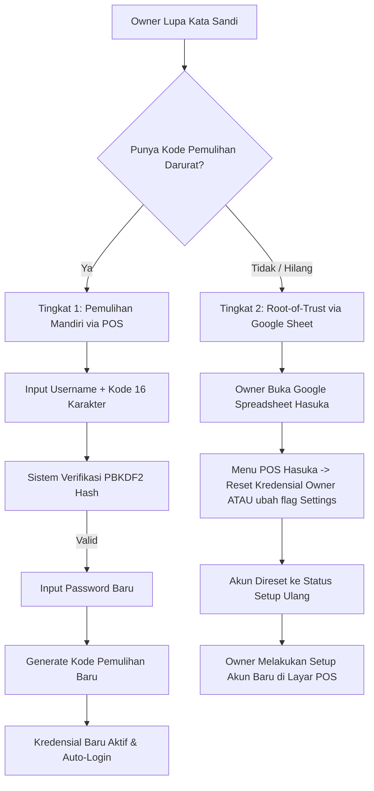

# PRD 10 — Manajemen Kredensial Owner: Keamanan, Setup Awal & Pemulihan Kata Sandi

**Proyek:** POS Kasir Hasuka Dimsum (Outlet GOR Satria & Multi-Outlet)  
**Status:** Draft / Ready for Review  
**Branch Terkait:** `feat/owner-auth-security`  
**Induk Dokumen:** `00-PRD-Overview.md`, `08-PRD-Google-Ecosystem-Alternative.md`  

---

## 1. Latar Belakang & Masalah

Pada implementasi awal (`LoginScreen.tsx`):
1. **Kredensial Default Terbuka:** Kredensial owner masih menggunakan fallback statis (`admin`/`admin123` atau `owner`/`hasuka888`).
2. **Penyimpanan Plaintext:** Username dan password tersimpan mentah (*plaintext*) di browser `localStorage` (`hasuka_owner_username`, `hasuka_owner_password`), sehingga siapapun yang membuka DevTools atau memeriksa perangkat dapat melihatnya tanpa proteksi.
3. **Tidak Ada Sinkronisasi Antar-Perangkat:** Bila owner mengakses dari ponsel/tablet lain, kredensial lokal tidak terbaca dan kembali ke nilai default.
4. **Ketiadaan Setup Awal (Onboarding Wizard):** Tidak ada alur formal bagi owner untuk mengklaim dan mengonfigurasi akun saat POS pertama kali di-deploy.
5. **Ketiadaan Alur Pemulihan (Forgot Password):** Bila owner lupa kata sandi, tidak ada mekanisme pemulihan mandiri yang aman (*self-service recovery*).

Dokumen ini mendefinisikan arsitektur keamanan, alur *Initial Setup*, dan mekanisme *Password Recovery* berlapis yang aman, mudah dipahami owner F&B, dan selaras dengan arsitektur hybrid Google Ecosystem (Sheets + Apps Script + Offline Outbox).

---

## 2. Tujuan & Prinsip Desain

1. **Owner-Defined Credentials:** Owner bebas menentukan Username dan Kata Sandi sesuai keinginannya tanpa batas kaku, namun dengan validasi kekuatan sandi (*password strength guard*).
2. **Zero Plaintext Storage:** Kata sandi dan kunci pemulihan tidak pernah disimpan atau ditransmisikan dalam teks mentah. Semua wajib di-hash menggunakan standar kriptografi modern berbasis Web Crypto API (*zero external heavy dependencies*).
3. **Resilien Offline & Multi-Device:** Kredensial master tersinkronisasi ke Google Sheets (terenkripsi/hash), dan salinan hash disimpan secara aman di penyimpanan lokal perangkat kasir untuk mendukung login saat offline.
4. **Self-Service Recovery:** Owner dapat memulihkan kata sandi secara mandiri menggunakan **Kode Pemulihan Darurat (Emergency Recovery Key)**.
5. **Root-of-Trust Fail-Safe:** Jika Owner kehilangan kata sandi *dan* kode pemulihannya, pemilik akun Google Spreadsheet memiliki wewenang *Master Reset* langsung melalui Google Apps Script / Sheet Settings tanpa risiko pengambilalihan akun oleh pihak ketiga.

---

## 3. Arsitektur Keamanan Kriptografi

### 3.1 Algoritma Hashing (Web Crypto API)
Menggunakan standar Web Crypto API bawaan browser (`window.crypto.subtle`) dan runtime modern (tanpa library eksternal rentan):
- **Algoritma:** PBKDF2 dengan pseudorandom function `HMAC-SHA256`.
- **Iterasi:** 100.000 putaran (*work factor* standar OWASP).
- **Salt:** 16-byte cryptographically secure random value (`crypto.getRandomValues(new Uint8Array(16))`), unik untuk setiap akun dan setiap perubahan sandi.
- **Format Penyimpanan Hash:** Hexadecimal string (64 karakter) atau Base64.

### 3.2 Struktur Data Master di Google Sheets (`Settings` Sheet)
Data konfigurasi akun disimpan di sheet `Settings` dalam format key-value:

| Key | Tipe Data | Contoh Nilai | Keterangan |
|---|---|---|---|
| `owner_is_configured` | Boolean string | `"true"` | Menandakan apakah setup awal telah selesai |
| `owner_username` | String | `"haryanto_hasuka"` | Username owner (case-insensitive saat verifikasi) |
| `owner_display_name` | String | `"Bpk. Haryanto"` | Nama lengkap untuk sapaan UI |
| `owner_password_hash` | Hex String | `"a4f9b2c...64chars"` | Hasil PBKDF2 hash dari password |
| `owner_password_salt` | Hex String | `"e81a3f0...32chars"` | Salt unik password |
| `owner_recovery_hash` | Hex String | `"c3d1e9a...64chars"` | Hasil PBKDF2 hash dari Kode Pemulihan |
| `owner_recovery_salt` | Hex String | `"b72e1c9...32chars"` | Salt unik kode pemulihan |
| `owner_updated_at` | ISO Timestamp | `"2026-11-05T19:00:00+07:00"` | Waktu terakhir kredensial diperbarui |
| `owner_reset_flag` | String | `"NONE"` / `"FORCE_RESET"` | Flag darurat dari pemilik spreadsheet |

### 3.3 Proteksi Serangan Brute-Force & Rate Limiting
- **Percobaan Maksimum:** 5 kali berturut-turut gagal login.
- **Lockout Tingkat 1 (5 kali salah):** Form login diblokir selama 60 detik dengan hitung mundur (*countdown timer*).
- **Lockout Tingkat 2 (8 kali salah):** Form login diblokir selama 15 menit.
- **Audit Alert:** Notifikasi indikator peringatan visual di layar login bila ada aktivitas login mencurigakan.

---

## 4. Alur 1: Proses Setup Awal (First-Run Onboarding)

### 4.1 Deteksi Status Sistem
Saat aplikasi pertama kali dibuka (di web maupun tablet kasir):
1. Sistem memanggil `gasApi.getInitialData()` atau memeriksa local settings.
2. Jika `owner_is_configured !== 'true'` dan tidak ditemukan hash kredensial:
   - Login tab Owner menampilkan banner informasi: *"Akun Pemilik Belum Dikonfigurasi"*.
   - Muncul tombol utama: **"Mulai Setup Akun Pemilik"** yang membuka Modal Setup Wizard 4 langkah.

### 4.2 Langkah-Langkah Setup Wizard

#### Langkah 1: Profil Usaha & Pemilik
- Input: Nama Pemilik Toko (misal: "Bpk. Haryanto").
- Input: Nama Usaha / Gerai Utama (default: "Hasuka Dimsum - GOR Satria").

#### Langkah 2: Kredensial Owner
- Input: **Username** (minimal 4 karakter alfanumerik, tanpa spasi).
- Input: **Kata Sandi** (minimal 8 karakter).
  - Dilengkapi *Strength Meter* interaktif:
    - Merah (Kurang): < 8 karakter.
    - Kuning (Sedang): >= 8 karakter dengan kombinasi huruf & angka.
    - Hijau (Kuat): >= 8 karakter dengan kombinasi huruf besar, kecil, angka, dan simbol.
- Input: **Konfirmasi Kata Sandi** (validasi real-time kecocokan).
- Toggle tampilkan/sembunyikan kata sandi (ikon mata).

#### Langkah 3: Kode Pemulihan Darurat (Emergency Recovery Key)
- Sistem menghasilkan 16 karakter acak kriptografis terkelompok:  
  **Format:** `HSK-XXXX-XXXX-XXXX` (contoh: `HSK-7W9B-4M2Q-89LK`).
- Tombol aksi:
  1. **Salin Kode** (menyalin ke clipboard perangkat).
  2. **Cetak / Simpan Lembar Darurat** (cetak via thermal printer kasir atau download berkas teks instruksi).
- Checkbox validasi wajib:  
  *"[x] Saya telah mencatat/menyimpan kode pemulihan ini di tempat yang aman. Saya mengerti bahwa kode ini digunakan jika saya lupa kata sandi."*

#### Langkah 4: Aktivasi & Komit Data
- Sistem membuat salt acak untuk password dan salt terpisah untuk recovery key.
- Menghasilkan `owner_password_hash` dan `owner_recovery_hash`.
- Mengirim payload ke Apps Script `saveSettings` dan menyimpannya ke `localStorage` / SQLite lokal.
- Menampilkan pesan selamat dan mengarahkan owner langsung ke Owner Dashboard.

---

## 5. Alur 2: Skenario Jika Owner Lupa Kata Sandi

Pemulihan dirancang dalam dua tingkat (*two-tier recovery architecture*):

### 5.1 Tingkat 1: Pemulihan Mandiri (Self-Service via Emergency Recovery Key)
1. Pada form login Owner, klik tautan **"Lupa kata sandi?"**.
2. Muncul dialog modal **"Pemulihan Kata Sandi Pemilik"**.
3. Owner menginput:
   - Username yang terdaftar.
   - Kode Pemulihan Darurat 16 karakter (`HSK-XXXX-XXXX-XXXX`).
4. Sistem menghitung hash dari kode yang dimasukkan dengan salt yang tersimpan di server/lokal.
5. Jika valid:
   - Tampil form pembuatan **Kata Sandi Baru**.
   - Sistem menerbitkan **Kode Pemulihan Darurat BARU** (aturan *One-Time Use* / *Single-Use Key* demi keamanan; kode lama otomatis hangus).
   - Data diperbarui ke server dan lokal.
6. Proteksi Brute-Force:
   - Salah input kode pemulihan sebanyak 3 kali berturut-turut akan mengunci modal pemulihan selama 10 menit.

### 5.2 Tingkat 2: Opsi Darurat Tertinggi (Root-of-Trust via Google Sheets)
Jika owner kehilangan password **sekaligus** kehilangan catatan kode pemulihannya:
1. Karena sistem berjalan di atas Google Sheets yang dimiliki akun Google Owner, akun Google tersebut adalah sumber otoritas tertinggi (*ultimate owner*).
2. Terdapat 2 opsi mudah tanpa perlu keahlian teknis pemrograman:
   - **Opsi Menu Apps Script:** Di menu atas Google Sheet terdapat menu kustom:  
     `POS Hasuka` $\rightarrow$ `Keamanan` $\rightarrow$ `Reset Akun Owner`.  
     Menu ini akan menghapus hash lama dan mengatur `owner_is_configured = "false"`.
   - **Opsi Edit Sheet Manual:** Owner membuka tab `Settings` di Google Sheets, mencari baris `owner_reset_flag`, dan mengubah isinya menjadi `"FORCE_RESET"`.
3. Ketika aplikasi POS dimuat ulang di tablet/HP, aplikasi langsung mendeteksi instruksi reset resmi dari Google Sheet, dan menampilkan antarmuka Setup Awal kembali untuk membuat Username & Password baru.

---

## 6. Fitur Penggantian Kredensial di Halaman Pengaturan (Settings)

Selain alur lupa password, owner yang sedang login harus dapat mengganti username dan password kapan saja dari dalam sistem:
- Lokasi: `SettingsScreen.tsx` $\rightarrow$ Tab baru **"Keamanan & Akun"** (atau sub-bagian di tab Outlet).
- Kontrol:
  1. Ubah Nama Tampilan & Username.
  2. Ganti Kata Sandi (Wajib memasukkan Kata Sandi Lama untuk konfirmasi keamanan).
  3. Regenerasi Kode Pemulihan Darurat (bila merasa kode lama pernah terlihat orang lain).

---

## 7. Rincian Teknis Implementasi

### 7.1 Modul Utilitas Kriptografi (`cryptoAuth.ts`)
Dibuat di `pos-kasir/src/utils/cryptoAuth.ts`:
- `generateSalt(byteLength = 16): string` (menggunakan `crypto.getRandomValues`)
- `hashSecret(secret: string, salt: string, iterations = 100000): Promise<string>` (PBKDF2 HMAC-SHA256)
- `verifySecret(secret: string, salt: string, expectedHash: string): Promise<boolean>`
- `generateRecoveryKey(): string` (format `HSK-XXXX-XXXX-XXXX`)
- `evaluatePasswordStrength(password: string): { score: number; label: string; color: string }`

### 7.2 Layanan Komunikasi API (`gasApi.ts` & `Code.gs`)
- Integrasi parameter `saveSettings` untuk menyimpan field `owner_*`.
- Penambahan fungsi pembantu di `Code.gs`:
  - `onOpen()`: Menambahkan menu `POS Hasuka` di Google Spreadsheet untuk trigger darurat reset owner.
  - Sanitasi pembacaan data di `getInitialData`: memastikan hanya hash/salt yang dikirim, bukan plaintext.

### 7.3 Komponen Antarmuka Pengguna (UI)
1. `OwnerSetupWizardModal.tsx`: Wizard 4 langkah untuk konfigurasi awal.
2. `OwnerForgotPasswordModal.tsx`: Dialog pemulihan mandiri dengan kode darurat.
3. Modifikasi `LoginScreen.tsx`:
   - Integrasi tombol & deteksi setup awal.
   - Pengecekan autentikasi menggunakan `verifySecret` (PBKDF2) menggantikan komparasi plaintext `localStorage`.
   - Countdown rate-limit lockout.
4. Modifikasi `SettingsScreen.tsx`: Tab Keamanan Akun untuk update profil dan ubah kata sandi.

---

## 8. Rencana Tahapan Eksekusi (Implementation Roadmap)

| Tahap | Aktivitas | Luaran (Deliverables) |
|---|---|---|
| **Fase 1** | Modul Kriptografi & Utilitas | `cryptoAuth.ts` + unit test verifikasi Web Crypto |
| **Fase 2** | Backend Apps Script & Helper Sheet | Update `Code.gs` (Menu reset spreadsheet & action sync) |
| **Fase 3** | UI Modal Setup Awal (Wizard) | `OwnerSetupWizardModal.tsx` dengan progress indicator |
| **Fase 4** | UI Modal Pemulihan Lupa Password | `OwnerForgotPasswordModal.tsx` dengan verifikasi recovery key |
| **Fase 5** | Integrasi Login & Settings | Refactor `LoginScreen.tsx` & Tab Keamanan di `SettingsScreen.tsx` |
| **Fase 6** | Verifikasi & Pengujian End-to-End | Test script login benar/salah, rate limiting, recovery flow, offline login |

---

## 9. Definition of Done (DoD)

- [ ] Tidak ada lagi kredensial plaintext (`admin123`, `hasuka888`) di kode sumber maupun `localStorage`.
- [ ] Kata sandi di-hash menggunakan PBKDF2-HMAC-SHA256 (100.000 iterasi) + salt unik 16-byte.
- [ ] Setup awal otomatis muncul jika akun owner belum pernah dibuat.
- [ ] Kode pemulihan darurat (16 karakter) dibuat saat setup awal dan dapat disalin/dicetak.
- [ ] Alur "Lupa Kata Sandi" berfungsi penuh menggunakan kode pemulihan dan merotasi kode baru setelah digunakan.
- [ ] Terdapat fail-safe reset darurat dari Google Spreadsheet milik owner.
- [ ] Proteksi rate limiting (lockout bertingkat setelah 5 kali gagal login) aktif.
- [ ] Login owner tetap berfungsi dalam kondisi offline (menggunakan salinan hash lokal).
- [ ] Kode bersih dari generic AI-slop, konsisten dengan gaya desain Hasuka Dimsum (Warm Gold & Terracotta Amber).
